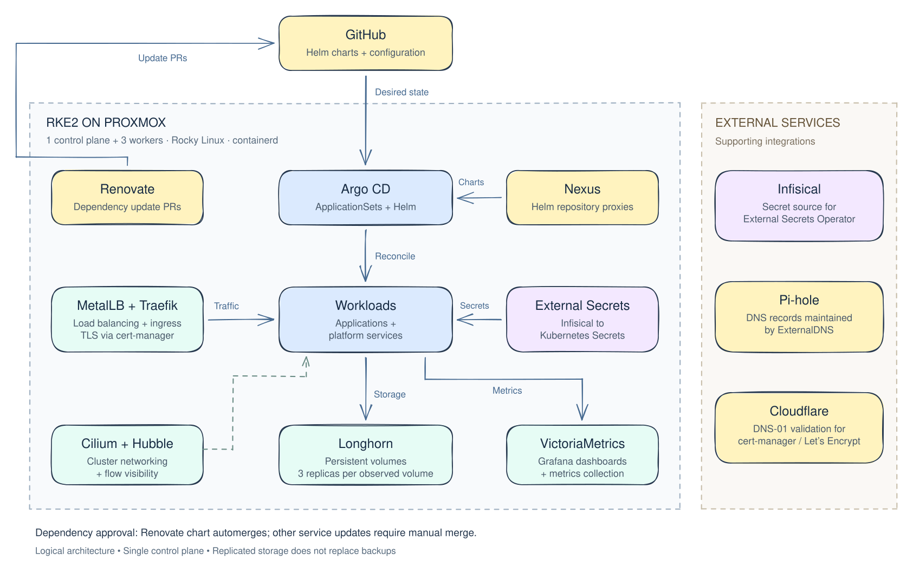

# Xavier's Homelab

<div align="center">
  
</div>

**A Kubernetes platform built to learn by operating it.**

This repository holds the configuration for my personal homelab. When I was hired as a DevSecOps Engineer, I quickly realized there was a lot I needed to learn. So, I purchased a Beelink Mini PC and the rest is history. Building and maintaining my own cluster gives me a place to work through deployment failures, networking, storage, and upgrades firsthand.


## Is Kubernetes Overkill for a Homelab?

Some may argue that Kubernetes is excessive for a homelab, but I see it as an opportunity:

- **Real-World Experience:** Many enterprises run Kubernetes in production. Why not gain hands-on experience at home?
- **Scalability & Flexibility:** Even in a homelab, container orchestration simplifies deployments, updates, and scaling.

While K8s has a learning curve, I believe the benefits outweigh the complexity, making it a valuable addition to my homelab, and in my career toolkit.

## Hardware

My homelab runs on a mix of physical and virtual machines. Here’s a breakdown of my setup:

| Component                 | Processor          | Memory       | Storage       |
|---------------------------|--------------------|-------------|--------------|
| **Beelink EQ13 Pro Mini PC** | Intel Core i9 12900HK | 16GB | 512GB  |
| **Beelink GTi12 Mini PC**  | Intel Alder Lake- N200 | 64GB   | 1TB  |

## Architecture



### Arhitecture Explanation
The diagram follows a change from Git to a running workload. **GitHub** holds the desired configuration. **Argo CD** watches that configuration and uses [**ApplicationSets**](kubernetes-deployments/core/argocd/values.yaml) to discover applications from the repository's directory structure. It renders their **Helm** charts and reconciles the resulting resources with the cluster, with automated sync, pruning, and self-healing enabled. Instead of pulling directly from upstream helm repos, I'm using **Nexus Repository Manager** as a proxy, giving chart dependencies a central access point within the lab.

[**Renovate**](renovate.json) feeds into this workflow by opening pull requests for **Helm** dependency updates. I keep most updates behind a manual merge so I can review the change before deployment; only **Renovate**'s own chart is eligible for automerge. Once a change reaches Git, and is merged into main, **Argo CD** handles deployment. This separates the decision to accept an update from the mechanics of applying it, while keeping the configuration history reviewable.

The workloads run on four **RKE2** virtual machines hosted on **Proxmox**: one control-plane node and three workers. [**Cilium**](kubernetes-deployments/core/cilium) provides networking between workloads, and **Hubble** makes those network flows visible. For incoming application traffic, [**MetalLB**](kubernetes-deployments/core/metallb) provides a load-balancer address on the local network and [**Traefik**](kubernetes-deployments/core/traefik) routes requests to the appropriate service. **ExternalDNS** maintains service DNS records in **Pi-hole**, while [**cert-manager**](kubernetes-deployments/core/cert-manager) obtains TLS certificates using **Let's Encrypt** and **Cloudflare** DNS validation.

Secrets follow a separate path from application configuration. **Infisical** holds the external secret values, and [**External Secrets Operator**](kubernetes-deployments/core/external-secrets/templates/secret-store.yaml) syncs the required values into **Kubernetes Secrets** for workloads to consume. This lets me keep references to secrets in Git without exposing them in the manifests. The external-services column shows these supporting integrations;  **Pi-hole**, and **Infisical** are deployed in containers outside of the cluster.  **Cloudflare** run inside this cluster.

[**Longhorn**](kubernetes-deployments/storage/longhorn) provides persistent storage for stateful services, including **Nexus**, **Grafana**, and [**VictoriaMetrics**](kubernetes-deployments/observability/victoria-metrics-k8s-stack). **VictoriaMetrics** collects metrics and **Grafana** presents them in dashboards, complementing **Hubble**'s network visibility. [**Gatus**](kubernetes-deployments/observability/gatus) provides a starting point for endpoint checks and Slack notifications. Together, these components let me follow a deployment beyond its manifests and inspect how the resulting workloads, storage, and network behave.

[Editable Excalidraw diagram](assets/homelab-architecture.excalidraw) · [Full-size image](assets/homelab-platform.svg)

To edit, download the `.excalidraw` file and open it in [Excalidraw](https://excalidraw.com). After editing, save the source and export an SVG to update the README image.

## Repository guide

```text
kubernetes-deployments/
├── core/             # GitOps, networking, DNS, certificates, secrets, dashboard
├── applications/     # Nexus and Renovate
├── observability/    # VictoriaMetrics stack, metrics-server, Gatus
└── storage/          # Longhorn
renovate.json         # Helm dependency update and merge policies
docs/                 # Verified cluster overview and operational notes
```

Each application directory contains a `Chart.yaml` declaring chart dependencies and a `values.yaml` defining local configuration. Some also include `templates/` for resources such as ExternalSecrets, issuers, or ingress configuration.


## Let's connect

I'm happy to discuss the design decisions, troubleshooting, and lessons behind this lab.

[LinkedIn](https://www.linkedin.com/in/xalexander/) · [Email](mailto:xalexander51@gmail.com) · [Repository discussions via issues](https://github.com/xalxnder/homelab/issues)
